<a href="https://abhisheksreesaila.github.io/omxlabs/"></a>

<a href="https://github.com/abhisheksreesaila/omxcode"></a>&nbsp;<a href="https://github.com/abhisheksreesaila/omxcode/tree/main/examples/console"></a>

<a href="https://github.com/abhisheksreesaila/omxcore"></a>&nbsp;<a href="https://github.com/abhisheksreesaila/omxcode"></a>&nbsp;<a href="https://github.com/abhisheksreesaila/omxqua"></a>

<a href="https://abhisheksreesaila.github.io/omxpert-dispatch/"></a>

<a href="https://github.com/abhisheksreesaila/fh-saas"></a>&nbsp;<a href="https://github.com/abhisheksreesaila/personalnote"></a>

<a href="https://github.com/abhisheksreesaila/travelos"></a>&nbsp;<a href="https://github.com/abhisheksreesaila/abode"></a>

<a href="https://abhisheksreesaila.github.io/omxlabs/">omxlabs</a> &nbsp;·&nbsp; <a href="https://www.youtube.com/@mojomondayai">Mojo Monday on YouTube</a> &nbsp;·&nbsp; every number comes from a script, on one RTX 3090

