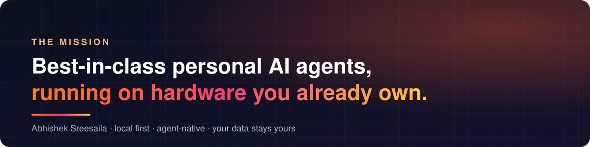

## 👋 Abhishek Sreesaila

Your machine, your data, your agents. I build with best-in-class tools, agent-native from day one, and every project here moves toward one goal: **personal AI that runs locally and works for you.**

### ⚙️ The engine: run AI on your own hardware

| Project | What it does |
| :--- | :--- |
| 🔥 **[MXConsole](https://github.com/abhisheksreesaila/mxstudio)**  | **Local AI in one command.** Any model, an OpenAI-compatible endpoint, on your own GPU. Models load when called and sleep when idle. |
| ⚡ **[MXFrame](https://github.com/abhisheksreesaila/mxframe)**  | **Modern GPU-native dataframes.** Mojo kernels, one codebase for NVIDIA, AMD and Apple Silicon. |

### 🧰 The tools: build agent-native apps fast

| Project | What it does |
| :--- | :--- |
| 🧩 **[fh-saas](https://github.com/abhisheksreesaila/fh-saas)**  | **Modern FastHTML for SaaS apps.** Login, billing and tenants in plain Python. |
| 🎨 **MXApp**  | **One language for every screen.** A universal language for GUI development. |

### 🏡 The apps: where your agents live

| Project | What it does |
| :--- | :--- |
| 📝 **[PersonalNote](https://github.com/abhisheksreesaila/personalnote)**  | **Your second brain, done right.** A best-in-class personal notebook with a modern interface and real mind maps. |
| ✈️ **[GitAway](https://github.com/abhisheksreesaila/travelos)**  | **Your travel story, on GitHub's model.** Plan a getaway, share it, let friends fork it. |
| 🛸 **[Abode](https://github.com/abhisheksreesaila/abode)**  | **One home for all your coding agents.** A T3 Code fork with a VS Code-style agents window and local voice. |
