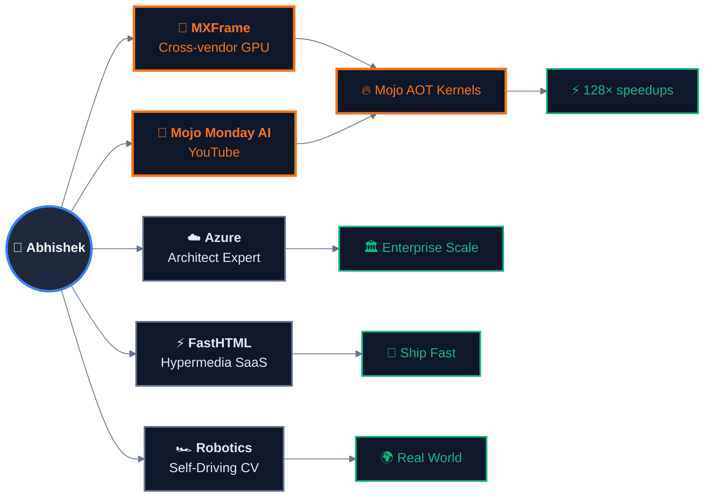

# 👋 Abhishek Sreesaila

### 🚀 Building cross-vendor GPU compute · 🎥 Teaching Mojo · ☁️ Azure Solutions Architect Expert

*Where Python ergonomics meet bare-metal performance.*

---

> ### 💭 *"Local AI is the mission. MAX is the weapon. Your hardware is enough."*

---

## 🚀 Featured: MXFrame — GPU DataFrames Without the CUDA Tax

> **Polars-style ergonomics. Mojo AOT kernels. One codebase → NVIDIA, AMD, and Apple Silicon.**
> No CUDA lock-in. No JIT at query time. Just pre-compiled speed.

### ⚡ `0.7 ms` — a 6-table join over **10 million rows** *(TPC-H Q9)*
### That's **128× faster than Polars.** On the CPU.

### 🔥 Why it hits different

|  | pandas | Polars | cuDF | **🚀 MXFrame** |
| :--- | :---: | :---: | :---: | :---: |
| 🎮 GPU support | ❌ | ❌ | NVIDIA only | ✅ **NVIDIA / AMD / Apple** |
| ⚙️ Kernels | ❌ | Rust | CUDA JIT | ✅ **Mojo AOT** (compiled once) |
| 🐍 SQL frontend | ❌ | ✅ | ✅ | ✅ `sql("SELECT ...")` |
| 📦 Install | pip | pip | full CUDA stack | ✅ `pixi install` |
| 🧬 Written in | C | Rust | C++/CUDA | ✅ **93% Mojo** |

### 📊 Scoreboard — All 22 TPC-H Queries vs Polars

<table>
<tr>
<td align="center" width="25%">

### 🏆 **21 / 22**
CPU wins @ 1M rows

</td>
<td align="center" width="25%">

### 🏆 **18 / 22**
CPU wins @ 10M rows

</td>
<td align="center" width="25%">

### 🎮 **16 / 22**
GPU wins @ 1M rows

</td>
<td align="center" width="25%">

### 🎮 **15 / 22**
GPU wins @ 10M rows

</td>
</tr>
</table>

### 💥 Headline speedups @ 10M rows (vs Polars, warm median of 3)

| 🥇 **128×** | 🥈 **89×** | 🥉 **42×** | ⚡ **32×** | 🎯 **24×** | 🔥 **22×** |
| :---: | :---: | :---: | :---: | :---: | :---: |
| **Q9** · 6-table join | **Q12** · join + agg | **Q7** · shipping vol | **Q8** · market share | **Q17** · small-qty | **Q5** · multi-join |

> 🧪 **Fully reproducible** — official TPC-H data via DuckDB `dbgen`, benchmark CSVs committed in-repo, one script to rerun · RTX 3090 + AMD 12-core
> ✅ All 22 queries verified correct against Polars output · 📦 Live on PyPI

### ➡️ **[Explore mxframe →](https://github.com/abhisheksreesaila/mxframe)**

---

## 🎥 Mojo Monday AI — *Mastering the Future of AI*

<table>
<tr>
<td width="40%" align="center" valign="middle">

### ▶️ **[youtube.com/@mojomondayai](https://www.youtube.com/@mojomondayai)**

</td>
<td width="60%" valign="middle">

The weekly deep-dive into the language and runtime powering the next wave of AI compute. **Mojo, MAX, GPU kernels — and the engineering that makes 128× look easy.**

🔥 New episode every **Monday**
🧠 First principles → production patterns
⚡ The exact same Mojo behind MXFrame's benchmarks, demystified on camera

</td>
</tr>
</table>

---

## 🛠️ The Rest of the Stack

<table>
<tr>
<td width="50%" valign="top">

### 🔥 Mojo GPU Tutorials
**[mojo-gpu-tutorials →](https://github.com/abhisheksreesaila/mojo-gpu-tutorials)**

The code companion to the channel. Hands-on Mojo & Modular MAX walkthroughs — clone it, run it, break it, learn it.

</td>
<td width="50%" valign="top">

### ☁️ Azure Architecture
**Solutions Architect Expert (Certified)**

Enterprise-scale infrastructure design. Identity, networking, governance — the load-bearing stuff nobody notices until it's missing.

</td>
</tr>
<tr>
<td width="50%" valign="top">

### ⚡ FastHTML Ecosystem
**[fh-saas →](https://github.com/abhisheksreesaila/fh-saas)** · **[fh-matui →](https://github.com/abhisheksreesaila/fh-matui)**

Production SaaS patterns and Material UI components. Hypermedia-first, zero build step, ship the same day.

</td>
<td width="50%" valign="top">

### 🏎️ Self-Driving Cars
**[Self-Driving Car Engineer →](https://github.com/abhisheksreesaila/Udacity-Self-Driving-Car-Engineer)**

Computer vision, sensor fusion, path planning. Where the cloud meets the road — literally.

</td>
</tr>
</table>

---

## 🧠 How it all connects

---

### 🤝 Let's connect

⭐ If mxframe saved you milliseconds (or hours), a star helps it find the people who need it. ▶️ If Mojo Monday taught you something, hit subscribe.

